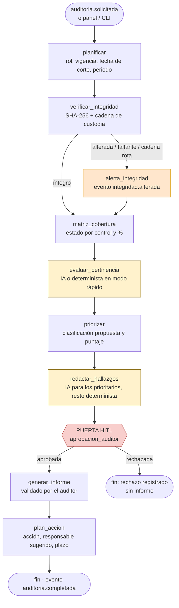
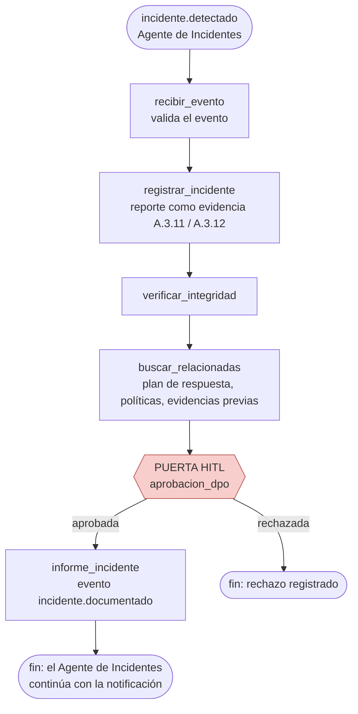
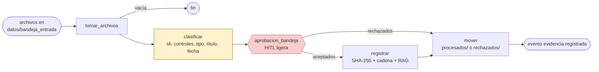
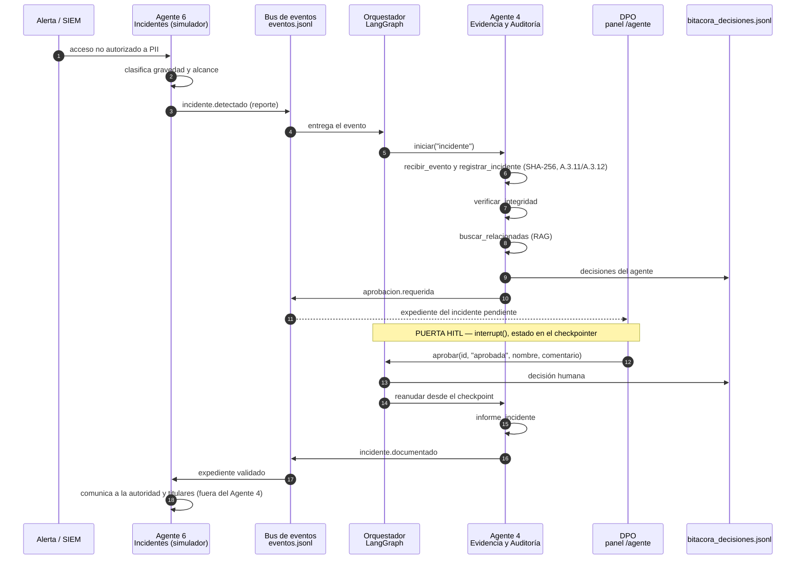
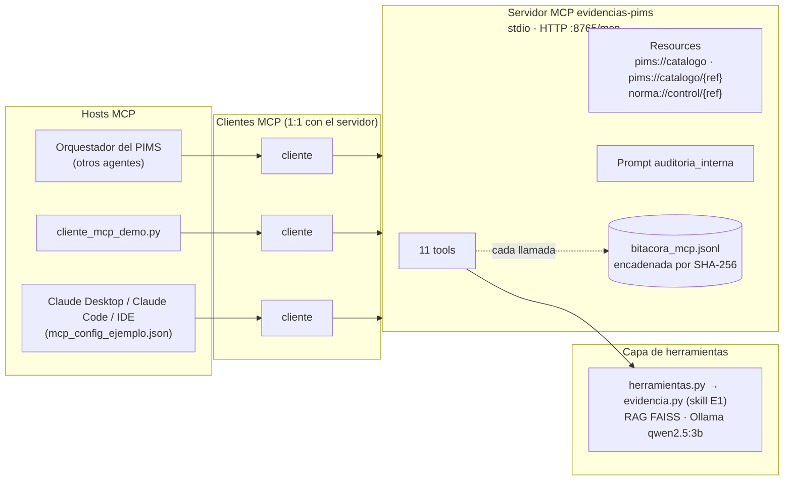

# Orquestación y automatización — Agente de Evidencia y Auditoría

Cubre la tarea del TIF *Orquestación y automatización: coordinación de skills,
agentes y flujos*. Describe cómo se encadenan las herramientas del agente
(grafos LangGraph), cómo se coordina con los otros agentes del PIMS (bus de
eventos y bus MCP), qué se automatiza y cómo queda todo trazado.

## 1. Piezas de la orquestación

| Pieza | Archivo | Papel |
|---|---|---|
| Capa de herramientas | `agente/herramientas.py` (+ `nucleo.py`) | Contrato común: 11 herramientas para agentes y una decisión solo humana |
| Orquestador | `agente/orquestador.py` | Grafos LangGraph `auditoria_interna`, `incidente` y `bandeja`; estado persistido; puertas HITL con `interrupt` |
| Bus de eventos | `agente/coordinacion.py` | Eventos entre agentes (`incidente.detectado`, `auditoria.solicitada`, `evidencia.nueva`) y simulador del Agente de Incidentes |
| Bus MCP | `agente/servidor_mcp.py`, `cliente_mcp_demo.py`, `mcp_config_ejemplo.json` | Servidor MCP `evidencias-pims`: tools, resources y prompt |
| Automatización | `agente/bandeja.py` | Vigilancia de `datos/bandeja_entrada` y verificación de integridad periódica |
| Panel humano | `agente/servidor_web.py` + `agente/web/` | `/agente`: línea de tiempo en vivo, aprobación humana, informes y bitácoras |
| Línea de comandos | `agente/cli_agente.py` | Mismos flujos desde la terminal (`python cli_agente.py auditoria --rapido`) |

API del orquestador (la usan la web y la CLI): `iniciar(tipo, proyecto, parametros)`,
`obtener(id)`, `listar(proyecto)` y `aprobar(id, decision, auditor, comentario,
decisiones_controles)`.

## 2. Grafos del orquestador (LangGraph)

Cada grafo es un `StateGraph`: los nodos son pasos que leen y escriben un estado
compartido y las aristas fijan el orden. Las puertas humanas usan `interrupt()`
de LangGraph: el grafo se detiene, el estado queda en el *checkpointer*
(`SqliteSaver` en `datos/ejecuciones/checkpoints.sqlite`) y se reanuda con la
decisión que llega del panel o de la CLI, aunque el proceso se haya reiniciado.
Tras cada paso se guarda además `datos/ejecuciones/<id>.json`, que es lo que
muestra la línea de tiempo del panel.

**Modo rápido** (`modo_rapido`). Ninguna llamada al LLM ni a los embeddings: la
pertinencia, la clasificación y los hallazgos se generan con textos
deterministas a partir del catálogo y de la matriz. Sirve para demostraciones en
la laptop del equipo (i5-6200U sin GPU) y para pruebas automáticas; las puertas
humanas se mantienen igual. En modo normal, por rendimiento, la IA solo evalúa
los `max_pertinencia` controles y redacta los `max_hallazgos` hallazgos más
prioritarios (3 por defecto); el resto se redacta de forma determinista y cada
hallazgo indica su origen (`ia` o `determinista`).

### 2.1 Grafo `auditoria_interna` (cláusula 9.2)

| Nodo | Herramienta | Tipo | Salida en el estado |
|---|---|---|---|
| planificar | `estado_expediente` | Determinista | Proyecto, rol, vigencia, fecha de corte, nº de evidencias |
| verificar_integridad | `verificar_integridad` | Determinista | OK / ALTERADA / FALTANTE / problemas de cadena |
| alerta_integridad | — | Determinista | Alerta crítica, evento `integridad.alterada`; la auditoría sigue con esas evidencias como *Comprometidas* |
| matriz_cobertura | `matriz_cobertura` | Determinista | Estado por control, % de cobertura, conteo por estado |
| evaluar_pertinencia | `evaluar_pertinencia` | IA (o determinista) | Propuestas para controles *Cubierto* / *Parcial*; no cambian el estado |
| priorizar | criterios de la skill | Determinista | Hallazgos ordenados por clasificación propuesta, estado, criticidad y tipo de requisito |
| redactar_hallazgos | `redactar_hallazgo` | IA (o determinista) | Hallazgo PRELIMINAR por control no cubierto |
| aprobacion_auditor | `decidir_pertinencia` (solo con la decisión humana) | Humano | Aprobada / rechazada, auditor, comentario, decisión por propuesta |
| generar_informe | `generar_informe` | Determinista | Informe en `datos/salidas/` |
| plan_accion | — | Determinista | Sección "Plan de acción correctiva": prioridad, control, acción, responsable sugerido, plazo y fecha límite (10.2) |

En la puerta, el auditor puede además aceptar o rechazar cada propuesta de
pertinencia; solo entonces el orquestador llama a `decidir_pertinencia` con su
nombre.

### 2.2 Grafo `incidente` (A.3.11, A.3.12, A.3.14)

El Agente de Evidencia **documenta** el incidente: escribe el reporte, lo
congela con hash para que sea evidencia válida, lo relaciona con lo que ya hay
en el expediente y lo presenta al DPO. La comunicación a la autoridad y a los
titulares que exige el reglamento de la Ley N.º 29733 es responsabilidad del
Agente de Incidentes y solo procede tras la aprobación humana.

### 2.3 Grafo `bandeja` (automatización del registro)

La puerta de la bandeja es ligera: el auditor confirma o rechaza cada archivo
con la clasificación propuesta. Con `auto_registrar` (vigilancia desatendida)
los archivos con controles propuestos se registran sin esperar y la decisión
queda en bitácora como "registro automático". En ambos casos, registrar no
equivale a dar el control por cumplido: solo prueba existencia, fecha e
integridad; la pertinencia sigue pasando por el auditor en la auditoría.

## 3. Coordinación con otros agentes

### 3.1 Bus de eventos

| Evento | Publica | Consume | Efecto |
|---|---|---|---|
| `incidente.detectado` | Agente 6 (Incidentes) — en la demo, su simulador | Agente 4 | Lanza el grafo `incidente` |
| `auditoria.solicitada` | Orquestador del PIMS / DPO / panel | Agente 4 | Lanza el grafo `auditoria_interna` |
| `evidencia.nueva` | Cualquier agente (1-8) | Agente 4 | Archivo a la bandeja → grafo `bandeja` |
| `aprobacion.requerida` | Agente 4 (orquestador) | Panel humano | Un flujo espera en una puerta HITL |
| `integridad.alterada` | Agente 4 | DPO, Agente 6 | Alerta crítica sobre el expediente |
| `auditoria.completada` | Agente 4 | Orquestador del PIMS, Agente 3 | Informe y plan de acción disponibles |
| `incidente.documentado` | Agente 4 | Agente 6 | Expediente del incidente validado por el DPO |
| `evidencia.registrada` | Agente 4 | Resto de agentes | Nueva evidencia con hash en el expediente |

Cada evento se anexa a `datos/eventos.jsonl` con su tipo, origen, fecha y carga
útil mínima (IDs y referencias, no contenido con PII).

### 3.2 Flujo de brecha (Flujo 2 de la guía)

### 3.3 Participación en el Flujo 1 (DPIA)

En el flujo DPIA de la guía, el Agente 4 aporta la documentación de soporte:
`buscar` y `matriz_cobertura` devuelven qué evidencias respaldan A.1.2.6 y
6.1.2, y `registrar` archiva la DPIA aprobada por el DPO con hash.

## 4. Bus MCP

El servidor `evidencias-pims` usa el SDK oficial de MCP para Python (FastMCP en
la v1 del SDK, `MCPServer` en la v2) y se ejecuta por **stdio** (el host lo
lanza como proceso) o por **HTTP streamable** en `http://127.0.0.1:8765/mcp`
(`python servidor_mcp.py --http`).

| Tool MCP | Herramienta | Tipo |
|---|---|---|
| `listar_proyectos` | `listar_proyectos` | Determinista, solo lectura |
| `estado_expediente` | `estado_expediente` | Determinista, solo lectura |
| `registrar_evidencia` | `registrar` | Determinista, escribe en el expediente |
| `verificar_integridad` | `verificar_integridad` | Determinista, anota en la cadena |
| `matriz_cobertura` | `matriz_cobertura` | Determinista, solo lectura |
| `generar_informe_auditoria` | `generar_informe` | Determinista; por MCP el informe sale siempre PRELIMINAR |
| `clasificar_evidencia` | `clasificar` | IA, no registra |
| `buscar_evidencia` | `buscar` | IA (embeddings) |
| `evaluar_pertinencia` | `evaluar_pertinencia` | IA, guarda la propuesta |
| `redactar_hallazgo` | `redactar_hallazgo` | IA |
| `preguntar_asistente` | `preguntar` | IA |
| — | `decidir_pertinencia` | **No publicada**: decisión humana |

`decidir_pertinencia` no es una tool porque, si lo fuera, el mismo LLM que
propone podría aprobarse a sí mismo; por la misma razón
`generar_informe_auditoria` no acepta "aprobado por". Los resources dan
contexto de solo lectura (catálogo de controles y texto de la norma por
control) y el prompt `auditoria_interna` guía al host por los pasos de la
skill. Los errores esperables se devuelven como mensaje claro, nunca como
traza.

## 5. Automatizaciones

| Automatización | Disparador | Qué hace | Archivo |
|---|---|---|---|
| Vigilancia de la bandeja (`vigilar`, cada 10 s) | Archivo nuevo y estable en `datos/bandeja_entrada/` | Ejecuta el grafo `bandeja` | `bandeja.py` |
| Verificación periódica de integridad (`verificar_periodica`, cada 24 h por defecto) | Temporizador | `verificar_integridad` sobre el expediente; una alteración publica `integridad.alterada` | `bandeja.py` |
| Respuesta a incidentes | Evento `incidente.detectado` | Grafo `incidente` hasta la puerta del DPO | `coordinacion.py` + `orquestador.py` |
| Auditoría bajo demanda | Evento `auditoria.solicitada`, panel o CLI | Grafo `auditoria_interna` hasta la puerta del auditor | `orquestador.py` |

Ninguna automatización emite un informe sin pasar por una persona.

## 6. Trazabilidad

| Registro | Archivo | Qué contiene | Pregunta que responde |
|---|---|---|---|
| Bitácora MCP | `datos/bitacora_mcp.jsonl` | Nº, fecha, tool, argumentos (rutas, nunca contenido), ok/error, duración; cada línea con el hash de la anterior | ¿Qué pidió cada cliente MCP y qué obtuvo? ¿Se alteró la bitácora? |
| Bitácora de decisiones | `datos/bitacora_decisiones.jsonl` | Ejecución, nodo, decisión, actor (agente o persona), si es humana, detalle | ¿Qué decidió el agente y quién aprobó o rechazó qué y por qué? |
| Bitácora de eventos | `datos/eventos.jsonl` | Tipo de evento, origen, fecha, carga mínima | ¿Qué agente pidió qué a quién? |
| Cadena de custodia | `expediente/cadena_custodia.log` | Registro, verificación y revisión de cada evidencia, encadenados por hash | ¿La evidencia es la misma que se archivó? |
| Estado de ejecuciones | `datos/ejecuciones/<id>.json` + `checkpoints.sqlite` | Pasos recorridos, resúmenes, resultados, puerta pendiente | ¿En qué paso está o quedó cada flujo? |

Las tres bitácoras son JSONL de solo anexado (una línea por hecho) y no guardan
el contenido de los documentos. El informe de auditoría termina con una
sección de trazabilidad que apunta a la ejecución y a estas bitácoras.

## 7. Por qué LangGraph (y no n8n o CrewAI)

| Criterio | LangGraph | n8n | CrewAI |
|---|---|---|---|
| Modelo | Grafo de estados explícito en Python | Flujos visuales de integración (Node.js) | Equipos de agentes con roles que conversan |
| Determinismo | Aristas fijas; el LLM solo en nodos concretos | Alto, pero orientado a integrar APIs | Bajo: el reparto de tareas lo decide el LLM |
| Pausa humana | `interrupt()` + checkpointer: se detiene y se reanuda tras un reinicio | Posible con nodos de espera / webhooks | No es un concepto central |
| Encaje con el proyecto | Mismo proceso Python que la skill y la app del E1 | Exige otro servidor y reescribir las llamadas como HTTP | Añade conversación entre agentes que aquí no hace falta |
| Ejecución local y privacidad | Biblioteca local, sin servicio adicional | Autohospedable, pero es otra pieza que operar | Local, con más llamadas al LLM (costoso en CPU) |
| Auditoría del flujo | Cada nodo y transición queda en el estado | Historial de ejecuciones en su base de datos | Trazas conversacionales, más difíciles de auditar |

El flujo de auditoría es mayoritariamente determinista (hash, integridad,
cobertura) con pocos pasos de juicio y puertas humanas obligatorias. Un grafo
explícito lo expresa tal cual y deja cada transición auditable. n8n sería útil
como capa de integración externa (correo, tickets) en un despliegue real y
podría consumir el mismo servidor MCP; CrewAI encaja mejor en tareas abiertas
de colaboración entre agentes, que no es el caso.
