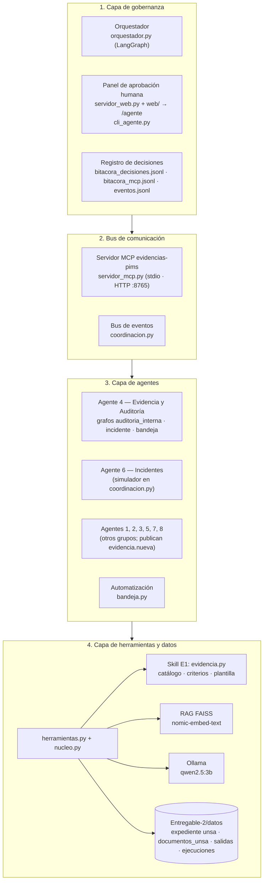

# Proyecto agéntico — integración y aplicación sobre la UNSA

Cubre la tarea del TIF *Proyecto agéntico: integración y aplicación de una
solución funcional*. Explica cómo se integran la skill y la aplicación del
Entregable 1 con el agente, el orquestador, el bus MCP y el panel humano, y
cómo se demuestra todo funcionando sobre documentos públicos reales de la UNSA.

## 1. Qué se integró

| Entregable 1 (se reutiliza tal cual) | Entregable 2 (se añade) |
|---|---|
| Skill `evidencia-auditoria-pims`: `evidencia.py`, catálogo, criterios, plantilla | `herramientas.py`: la skill como 11 herramientas con contrato JSON + 1 decisión humana |
| Aplicación AUDITA-PIMS (Flask) y asistente con RAG | `servidor_web.py`: la misma app en `/` y el panel del agente en `/agente` |
| RAG local (FAISS + `nomic-embed-text`) y LLM local | Modelo `qwen2.5:3b` (antes `qwen2.5:7b`) por rendimiento en CPU |
| Proyecto de ejemplo ficticio (ClinData S.A.C.) | Proyecto real `unsa` con documentos públicos y sus URLs (`fuentes.json`) |
| Pasos manuales en la web | Grafos LangGraph, bus de eventos, servidor MCP, bandeja y verificación periódica |

`nucleo.py` importa la aplicación del Entregable 1 sin copiarla y le indica que
use `Entregable-2/datos` como carpeta de datos. Así, una mejora de la skill
llega automáticamente al agente.

## 2. Arquitectura por capas

Adaptación de la arquitectura de referencia de la guía (gobernanza / bus MCP /
agentes / herramientas) a lo que existe en el repositorio.



| Capa | Componente real | Responsabilidad |
|---|---|---|
| Gobernanza | `orquestador.py`, `servidor_web.py` (`/agente`), `cli_agente.py`, bitácoras | Decidir el orden, detenerse en las puertas humanas, registrar cada decisión |
| Bus | `servidor_mcp.py`, `coordinacion.py` | Exponer el agente a otros agentes/hosts; transportar eventos entre agentes |
| Agentes | Grafos del Agente 4, simulador del Agente 6, `bandeja.py` | Ejecutar los flujos del PIMS |
| Herramientas y datos | `herramientas.py`, skill E1, FAISS, Ollama, `datos/` | Cálculo determinista, juicio del LLM local, persistencia |

## 3. Integración extremo a extremo

Recorrido completo de una evidencia de la UNSA:

1. **Origen.** Un documento público de la UNSA (por ejemplo, su política de
   privacidad) se descarga del sitio oficial; su URL queda en
   `datos/documentos_unsa/fuentes.json`.
2. **Ingreso.** Se registra en el expediente `unsa` (carga inicial o bandeja):
   `clasificar` propone controles y tipo, `registrar` calcula el SHA-256, lo
   anota en la cadena de custodia y lo indexa en FAISS.
3. **Seguimiento.** `bandeja.py` verifica periódicamente la integridad; si el
   archivo cambia, el control pasa a *Comprometida*.
4. **Auditoría.** `auditoria.solicitada` (o el botón del panel) lanza
   `auditoria_interna`: integridad → cobertura → pertinencia → prioridad →
   hallazgos → puerta del auditor.
5. **Decisión humana.** El grafo se detiene con `interrupt()` y su estado queda
   en el checkpointer; el auditor aprueba o rechaza en `/agente` y la decisión
   va a `bitacora_decisiones.jsonl`.
6. **Salida.** `generar_informe` escribe el informe en `datos/salidas/`,
   `plan_accion` le añade el plan de acción correctiva y se publica
   `auditoria.completada`.
7. **Coordinación.** Si llega `incidente.detectado`, el grafo `incidente`
   congela el reporte como evidencia y lo presenta al DPO.
8. **Exposición.** Cualquier host MCP (Claude Desktop, Claude Code, otro
   agente) puede pedir lo mismo por el servidor `evidencias-pims`, con el
   informe siempre preliminar; cada llamada queda en `bitacora_mcp.jsonl`.

Los controles cuya evidencia la UNSA no publica quedan *Sin evidencia*: el
agente no los rellena con documentos inventados y cada uno genera un hallazgo
preliminar (o una limitación de alcance que el auditor confirma).

## 4. Guía de demostración para la exposición (6-7 minutos)

### Antes de exponer (no cuenta en el tiempo)

```bash
ollama serve                      # si no está como servicio
ollama pull nomic-embed-text
ollama pull qwen2.5:3b
pip install -r Entregable-2/requirements.txt
cd Entregable-2/agente
python servidor_web.py            # http://127.0.0.1:5000/agente
```

- Abrir `http://127.0.0.1:5000/agente` y comprobar que el proyecto `unsa` tiene evidencias.
- Tener una segunda terminal en `Entregable-2/agente`.
- Guardar una copia de un PDF de `datos/documentos_unsa/` para el paso de la bandeja.
- Lanzar una vez `python cli_agente.py auditoria --rapido` para calentar los índices.

### Guion

| Tiempo | Paso | Qué se hace | Qué se muestra / se dice |
|---|---|---|---|
| 0:00-0:45 | 1. Contexto | Panel `/agente`; abrir `fuentes.json` | Agente 4 del PIMS multiagente; expediente con documentos **públicos reales** de la UNSA y sus URLs |
| 0:45-2:00 | 2. Auditoría interna | Botón **Iniciar auditoría interna** en modo rápido (o `python cli_agente.py auditoria --rapido`) | Línea de tiempo en vivo: planificar → integridad → cobertura → pertinencia → prioridad → hallazgos; el grafo se detiene en la puerta del auditor (`interrupt`) |
| 2:00-2:45 | 3. Puerta humana | Aprobar con nombre y comentario | La decisión aparece en **Bitácoras → Decisiones**; se genera el informe con su plan de acción correctiva y su sección de trazabilidad; abrirlo |
| 2:45-3:30 | 4. Hallazgos reales | Mostrar la matriz: controles *Sin evidencia* | Lo que la UNSA no publica no se inventa: es un hallazgo PRELIMINAR con criterio, condición, causa, efecto y recomendación |
| 3:30-4:30 | 5. Incidente | Botón **Simular incidente** | El Agente de Incidentes publica `incidente.detectado`; el reporte se registra con hash (A.3.11/A.3.12), se buscan evidencias relacionadas y queda pendiente del DPO; aprobar y ver `incidente.documentado` |
| 4:30-5:15 | 6. Bandeja | Copiar el PDF preparado a `datos/bandeja_entrada/` (o subirlo en **Bandeja de entrada**) | Clasificación propuesta, confirmación ligera del auditor, registro con SHA-256 y archivo movido a `procesados/`; evento `evidencia.registrada` en **Bitácoras → Eventos** |
| 5:15-6:15 | 7. Bus MCP | `python cliente_mcp_demo.py` en la segunda terminal | 11 tools, resources (`pims://catalogo`, `norma://control/{ref}`) y el prompt `auditoria_interna`; `decidir_pertinencia` no está publicada; **Bitácoras → MCP** con cada línea encadenada por hash |
| 6:15-7:00 | 8. Cierre | Pestaña **Herramientas del agente** | Determinista vs. IA, control ISO de cada herramienta; todo local; el humano decide |

### Si algo falla durante la exposición

| Problema | Respuesta |
|---|---|
| Ollama lento o caído | Usar modo rápido (`--rapido`): todo lo determinista y las puertas humanas siguen funcionando |
| El panel no responde | Repetir desde la CLI: `python cli_agente.py auditoria --rapido`, `python cli_agente.py incidente "acceso no autorizado" --rapido`, `python cli_agente.py aprobar ID --auditor "Nombre"` |
| La bandeja tarda en reaccionar | Mostrar el resultado en **Bitácoras → Eventos** al final |
| Se quiere mostrar una alteración | Hacerlo al final: editar un archivo en `expediente/archivos/`, verificar (sale ALTERADA y el control *Comprometida*) y restaurar el original desde `datos/documentos_unsa/` |

## 5. Resultado

El proyecto agéntico queda integrado en una sola aplicación local:

- Un agente con objetivo, datos, contexto y herramientas definidos (`01-diseno-agente`).
- Tres flujos orquestados con puertas humanas, coordinación por eventos y un
  servidor MCP para otros agentes (`02-orquestacion`).
- Una aplicación funcional sobre una organización real, con casos de prueba
  (`pruebas/casos_prueba.md`) y pruebas automáticas (`pruebas/`).
